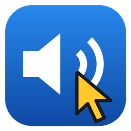
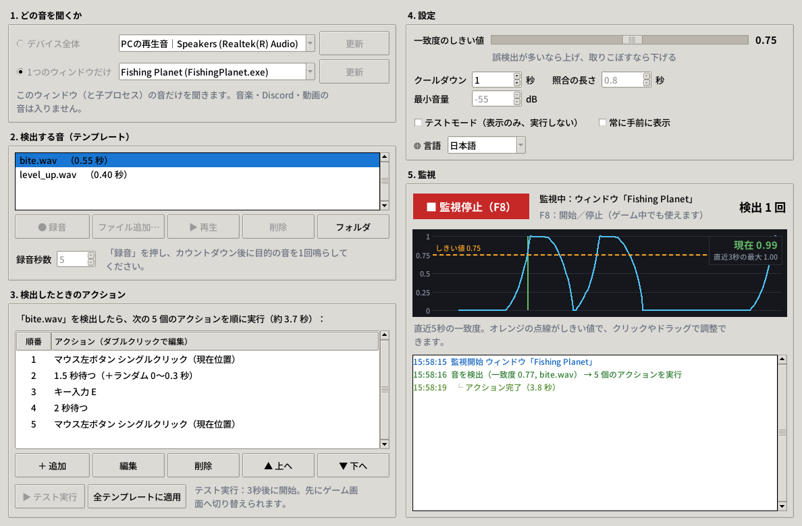

<p align="center"></p>

<h1 align="center">サウンドクリッカー SoundClicker</h1>

<p align="center">
<a href="README.md">English</a> | <a href="README.zh-TW.md">繁體中文</a> | <b>日本語</b>
</p>

<p align="center">指定した音が鳴ったら、自動でクリック・キー入力・待機……<br>
音を一度録音して、やりたい動作を決めて「監視開始」を押すだけです。</p>

<p align="center"><a href="https://github.com/remon2208/SoundClicker/releases/latest"><b>⬇ SoundClicker.exe をダウンロード</b></a>（Windows 10/11、インストール不要）</p>



## できること

- **PCの再生音を直接聞く**ので、部屋の雑音は関係ありません（マイクも選べます）。
- **1つのウィンドウだけ**（Windows 10 2004 以降）：ゲームの音だけを聞くので、音楽・Discord・動画で誤反応しません。
- **音ごとに自分だけのアクション**：マウスクリック（左／右／中、シングル／ダブル、現在位置または座標指定）、キー入力と組み合わせ（`e`、`space`、`ctrl+c` など）、押し続ける、待機（ランダムな追加時間も可）、マウス移動、ホイール。
- アクションの**テスト実行**、検出だけを記録する**テストモード**、しきい値を調整しやすい**一致度のリアルタイムグラフ**、ゲーム中でも **F8** で開始／停止。
- 画面は **日本語・繁體中文・English**（OSの言語で自動選択、設定から変更可能）。

## 使い方

1. `SoundClicker.exe` を起動します（初回に警告が出たら[下の説明](#windowsによってpcが保護されましたと表示される)を参照）。
2. **1. どの音を聞くか**：「デバイス全体 → PCの再生音」のまま、または「1つのウィンドウだけ」でゲームを選びます。
3. **2. 検出する音**：「● 録音」を押し、カウントダウン後に目的の音を1回鳴らします。「▶ 再生」で録音を確認できます。「ファイル追加…」も可能です（WAV。ソースから実行し `soundfile` を入れると mp3/ogg も可）。
4. **3. 検出したときのアクション**：初期設定は「左クリック → 2秒待つ → 左クリック」。「＋ 追加」「編集」「▲▼」で好きなように変更し、「▶ テスト実行」で試せます（3秒後に開始するので、その間にゲームへ切り替えられます）。
5. 「▶ 監視開始（F8）」を押します。検出するたびに右下に記録されます。

### 調整のコツ

| 困っていること | 試すこと |
|---|---|
| 別の音でも反応する | 「一致度のしきい値」を上げる（グラフのオレンジ線をドラッグ）、または「1つのウィンドウだけ」を使う |
| 取りこぼす | しきい値を下げる、ゲームのBGMを小さくする、録音し直す |
| もっと速く反応させたい | 「照合の長さ」を短く（例：0.3 秒） |
| 1回の音で2回反応する | 「クールダウン」を長く |
| 同じ音に何種類かある | それぞれをテンプレートとして録音 |

## よくある質問

#### 「WindowsによってPCが保護されました」と表示される
exe にコード署名がないため SmartScreen が警告します。「詳細情報 → 実行」を押してください。PyInstaller で作った自動クリックツールをウイルス対策ソフトが誤検知することもあります。気になる場合は[ソースから実行](#ソースから実行)するか、自分で exe をビルドしてください。

#### ゲームがクリックやキー入力に反応しない
ゲームが管理者として実行されている場合は、このアプリも管理者として実行してください（右クリック →「管理者として実行」）。

#### 「1つのウィンドウだけ」がグレーになっている／エラーが出る
Windows 10 バージョン 2004 以降が必要です。ゲームが管理者として実行されている場合は、このアプリも管理者として起動してください。

#### 録音した音や設定はどこに保存されますか？
exe 版は `%APPDATA%\SoundClicker`（「フォルダ」ボタンで開けます）。ソースから実行した場合は `SoundClicker.pyw` と同じ場所です。

#### ゲームで使っても大丈夫？
オンラインゲームによっては自動化ツールが禁止されています。遊んでいるゲームの規約を確認し、自己責任でお使いください。

## ソースから実行

Windows と Python 3.9 以降が必要です（他のOSは未検証で、「1つのウィンドウだけ」は使えません）：

```bash
pip install -r requirements.txt
python SoundClicker.pyw
```

exe を自分で作るには `build.bat`、テストは `pip install pytest` のあと `python -m pytest` です。
push のたびに GitHub Actions がテストし、`soundclicker/__init__.py` の `__version__` が変わると新しい exe を自動で [Releases](https://github.com/remon2208/SoundClicker/releases) に公開します。

## 翻訳

画面の文言はすべて [`soundclicker/i18n.py`](soundclicker/i18n.py) にあります。修正や新しい言語の追加を歓迎します。

## ライセンス

[MIT](LICENSE)
