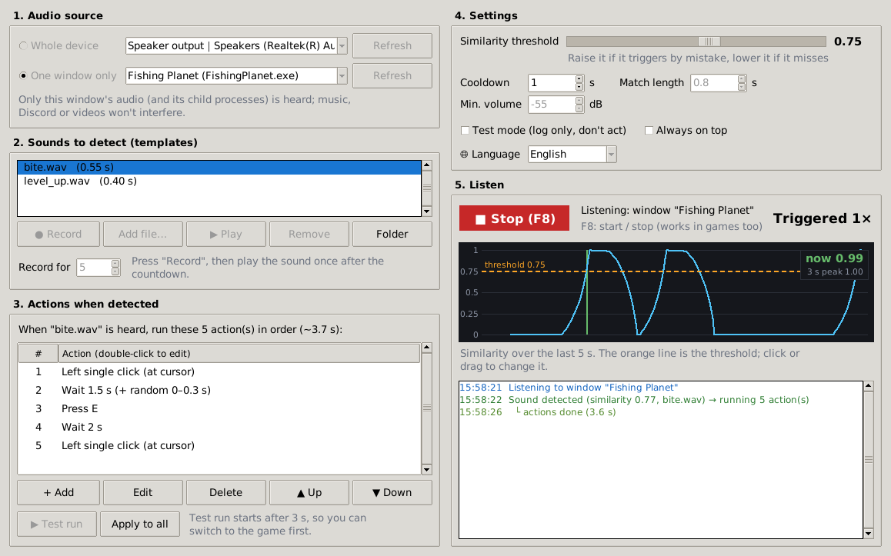

<p align="center"></p>

<h1 align="center">SoundClicker</h1>

<p align="center">
<b>English</b> | <a href="README.zh-TW.md">繁體中文</a> | <a href="README.ja.md">日本語</a>
</p>

<p align="center">Hear a specific sound → click, press keys, wait… automatically.<br>
Record the sound once, decide what should happen, press <b>Start</b>.</p>

<p align="center"><a href="https://github.com/remon2208/SoundClicker/releases/latest"><b>⬇ Download SoundClicker.exe</b></a> (Windows 10/11, no installation)</p>



## What it can do

- **Listens to what your PC plays**, so room noise doesn't matter — or to a microphone.
- **One window only** (Windows 10 2004+): listen to just the game, so music, Discord or videos can't trigger it.
- **Your own action list per sound**: mouse clicks (left / right / middle, single / double, at the cursor or at a fixed position), key presses and combinations (`e`, `space`, `ctrl+c`…), holding a key or button, waiting (optionally with a random extra), moving the mouse, scrolling.
- **Test run** your actions before using them, **test mode** to only log detections, a **live similarity graph** to tune the threshold, and **F8** to start / stop from inside a game.
- Interface in **English, 繁體中文 and 日本語** (picked automatically, changeable in Settings).

## How to use

1. Run `SoundClicker.exe` (see [the warning below](#windows-protected-your-pc) the first time).
2. **1. Audio source** – keep *Whole device → Speaker output*, or choose *One window only* and pick the game.
3. **2. Sounds to detect** – press **● Record**, and play the sound once when the countdown ends. **▶ Play** lets you check the recording. You can also **Add file…** (WAV; mp3/ogg when running from source with `soundfile`).
4. **3. Actions when detected** – the default is *left click → wait 2 s → left click*. Use **+ Add** / **Edit** / **▲▼** to make it your own, and **▶ Test run** to try it (it starts after 3 s so you can switch to the game).
5. Press **▶ Start (F8)**. Every detection is logged on the right.

### Tuning

| Problem | Try |
|---|---|
| Triggers on other sounds | raise **Similarity threshold** (drag the orange line on the graph) or use *One window only* |
| Misses the sound | lower the threshold, turn the game music down, or record the sound again |
| Should react faster | lower **Match length** (e.g. 0.3 s) |
| Triggers twice for one sound | raise **Cooldown** |
| Several variants of a sound | record each of them as its own template |

## FAQ

#### "Windows protected your PC"
The .exe isn't code-signed, so SmartScreen warns about it. Click **More info → Run anyway**. Some antivirus tools also flag auto-clickers built with PyInstaller; you can always [run from source](#run-from-source) or build the .exe yourself instead.

#### The game ignores the clicks / keys
If the game runs as administrator, SoundClicker must run as administrator too (right-click → *Run as administrator*).

#### "One window only" is greyed out or shows an error
It needs Windows 10 version 2004 or newer. If the game runs as administrator, run SoundClicker as administrator as well.

#### Where are my recordings and settings?
`%APPDATA%\SoundClicker` for the .exe (the **Folder** button opens it). When running from source they are stored next to `SoundClicker.pyw`.

#### Is it allowed in my game?
Some online games forbid automation tools. Check the rules of the game you play — you use this tool at your own risk.

## Run from source

Python 3.9 or newer on Windows (other systems are untested and can't use *One window only*):

```bash
pip install -r requirements.txt
python SoundClicker.pyw
```

Build the .exe yourself with `build.bat`, run the tests with `pip install pytest` then `python -m pytest`.
GitHub Actions tests every push; when `__version__` in `soundclicker/__init__.py` changes, the new .exe is built and published on the [Releases](https://github.com/remon2208/SoundClicker/releases) page automatically.

<details>
<summary>How the detection works</summary>

The recording is trimmed to the sound itself and turned into a mel spectrogram (64 bands, 10 ms frames).
While listening, the newest audio is compared with each template every 10 ms using a weighted correlation that
focuses on the template's loudest parts, so background music lowers the score much less than it would with a
plain comparison. It ignores volume, tolerates slight pitch changes, and a hit needs the similarity to reach the
threshold. "One window only" uses the Windows process-loopback API (`ActivateAudioInterfaceAsync` with
`AUDIOCLIENT_ACTIVATION_TYPE_PROCESS_LOOPBACK`).
</details>

## Translations

All interface text lives in [`soundclicker/i18n.py`](soundclicker/i18n.py). Corrections and new languages are welcome.

## License

[MIT](LICENSE)
