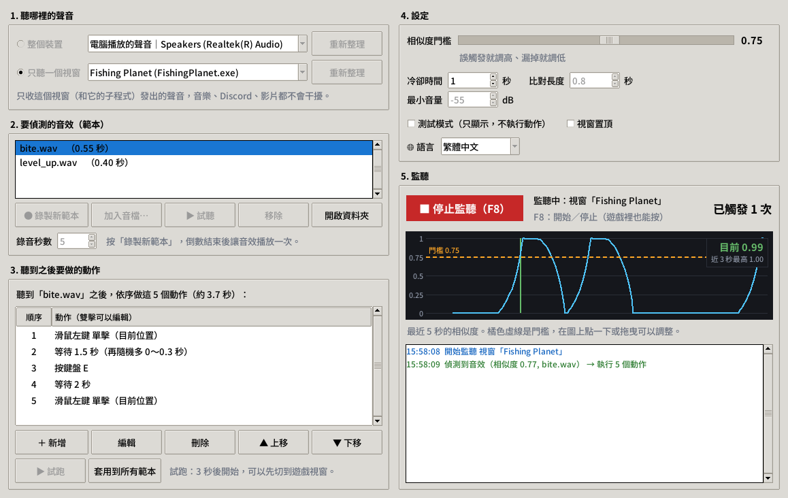

<p align="center"></p>

<h1 align="center">音效自動點擊 SoundClicker</h1>

<p align="center">
<a href="README.md">English</a> | <b>繁體中文</b> | <a href="README.ja.md">日本語</a>
</p>

<p align="center">聽到指定的音效 → 自動點擊、按鍵、等待……<br>
先錄一次那個聲音，設定要做的動作，按下「開始監聽」就好。</p>

<p align="center"><a href="https://github.com/remon2208/SoundClicker/releases/latest"><b>⬇ 下載 SoundClicker.exe</b></a>（Windows 10/11，免安裝）</p>



## 功能

- **直接聽電腦播出的聲音**，房間裡的噪音不會干擾；也可以改聽麥克風。
- **只聽一個視窗**（Windows 10 2004 以上）：只收遊戲本身的聲音，音樂、Discord、影片都不會誤觸發。
- **每個音效各自一串動作**：滑鼠點擊（左／右／中鍵、單擊／雙擊、目前位置或指定座標）、鍵盤按鍵與組合鍵（`e`、`space`、`ctrl+c`…）、按住不放、等待（可加隨機秒數）、移動滑鼠、滾輪。
- **試跑**動作、**測試模式**（只顯示不執行）、**即時相似度圖**方便調門檻，遊戲裡按 **F8** 就能開始／停止。
- 介面有 **繁體中文、日本語、English**（自動依系統語言，也能在設定裡切換）。

## 使用方式

1. 執行 `SoundClicker.exe`（第一次若出現警告，請看[下面的說明](#出現windows-已保護您的電腦)）。
2. **1. 聽哪裡的聲音**：用「整個裝置 → 電腦播放的聲音」，或選「只聽一個視窗」再挑遊戲。
3. **2. 要偵測的音效**：按「● 錄製新範本」，倒數結束後讓音效播放一次；按「▶ 試聽」可以確認錄到的聲音。也可以「加入音檔…」（WAV；從原始碼執行並安裝 `soundfile` 後也能用 mp3/ogg）。
4. **3. 聽到之後要做的動作**：預設是「左鍵 → 等待 2 秒 → 左鍵」。用「＋ 新增」「編輯」「▲▼」改成你要的，按「▶ 試跑」先試一次（3 秒後才開始，可以先切到遊戲）。
5. 按「▶ 開始監聽（F8）」。每次偵測到都會記錄在右下角。

### 調整技巧

| 狀況 | 怎麼做 |
|---|---|
| 別的聲音也會觸發 | 調高「相似度門檻」（可直接拖曳圖上的橘線），或改用「只聽一個視窗」 |
| 常常漏掉 | 調低門檻、把遊戲音樂調小，或重錄一次範本 |
| 想反應快一點 | 「比對長度」調短，例如 0.3 秒 |
| 一次聲音觸發兩次 | 調長「冷卻時間」 |
| 同一個音效有好幾種版本 | 每種各錄一個範本 |

## 常見問題

#### 出現「Windows 已保護您的電腦」
因為 exe 沒有數位簽章，SmartScreen 會跳警告。按「其他資訊 → 仍要執行」即可。有些防毒軟體也會誤判用 PyInstaller 打包的自動點擊程式；不放心的話可以改用[原始碼執行](#從原始碼執行)或自己打包。

#### 遊戲沒反應（點擊或按鍵沒作用）
如果遊戲是用系統管理員身分執行的，這個程式也要用系統管理員身分執行（右鍵 →「以系統管理員身分執行」）。

#### 「只聽一個視窗」是灰色的或出現錯誤
需要 Windows 10 2004 以上。遊戲若用系統管理員身分執行，本程式也要用系統管理員身分開。

#### 錄好的範本和設定存在哪裡？
exe 版在 `%APPDATA%\SoundClicker`（按「開啟資料夾」就會打開）。從原始碼執行時存在 `SoundClicker.pyw` 旁邊。

#### 遊戲允許用這種工具嗎？
部分線上遊戲禁止使用自動化工具，請先確認遊戲規範，使用風險請自行負責。

## 從原始碼執行

需要 Windows 和 Python 3.9 以上（其他系統未測試，也不能用「只聽一個視窗」）：

```bash
pip install -r requirements.txt
python SoundClicker.pyw
```

想自己打包 exe 就執行 `build.bat`；測試用 `pip install pytest` 後執行 `python -m pytest`。
每次推上 `v*` 標籤，GitHub Actions 會自動測試、打包並發佈到 [Releases](https://github.com/remon2208/SoundClicker/releases)。

## 翻譯

介面文字都在 [`soundclicker/i18n.py`](soundclicker/i18n.py)，歡迎修正或新增語言。

## 授權

[MIT](LICENSE)
